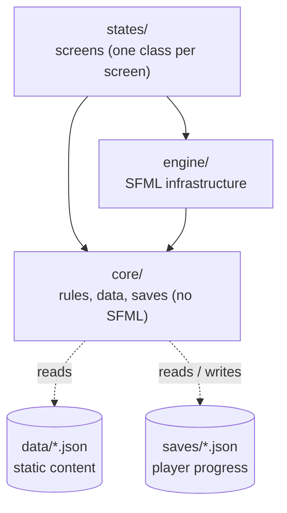
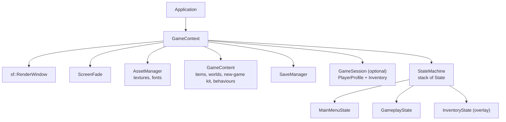
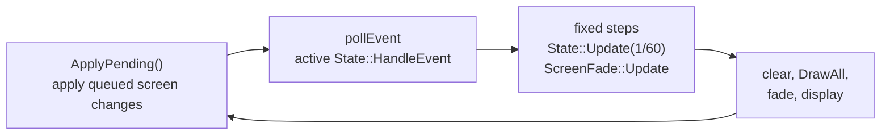
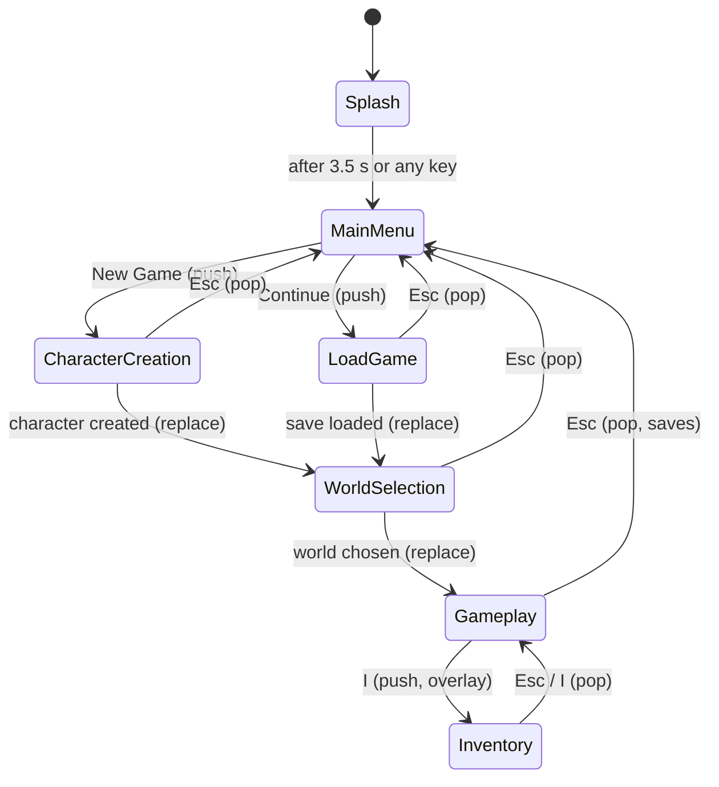

# Architecture

> [Docs index](README.md) · Next: [Inventory](features/inventory.md) · [Engine](features/engine.md) · [Conventions](guides/conventions.md)

This document describes **how Oathbound is organised**: the technical architecture (layers, build targets,
runtime objects), the functional architecture (what the game does and where each capability lives), and the
purpose of every folder and file.

## Contents

1. [Overview](#1-overview)
2. [Technical architecture](#2-technical-architecture)
3. [Functional architecture](#3-functional-architecture)
4. [Project layout](#4-project-layout)
5. [Folder rules: what belongs where](#5-folder-rules-what-belongs-where)
6. [Key design decisions](#6-key-design-decisions)
7. [Where do I put...?](#7-where-do-i-put)

---

## 1. Overview

Oathbound is a 2D RPG written in **C++17** with **SFML 2.6**, built with **CMake**.

The code is split in **three layers** with a strict, one-way dependency rule, so that the game rules
can be tested without a window and the graphics library can be replaced without touching them.

| Principle | What it means in practice |
|---|---|
| **Core knows nothing about rendering** | `src/core` never includes SFML. It is built as its own library and unit-tested. |
| **Data is not code** | Items, worlds and the starting kit live in JSON files under `data/`. Adding content rarely needs C++. |
| **Identify by stable string ids** | Saves refer to `"potion_health"`, never to an index or an enum, so content can evolve without corrupting saves. |
| **Never destroy player data** | Loading is tolerant: unknown or renamed items are kept, saves are written atomically, backups are automatic. |
| **Screens only orchestrate** | A screen (state) reads input, calls core APIs, draws. Game rules are never written inside a screen. |

---

## 2. Technical architecture

### 2.1 Layers and dependency rule



**A layer may only depend on the layers below it.** `core` depends on nothing but the C++ standard
library and `nlohmann/json`. `engine` adds SFML. `states` use both.

| Layer | Folder | Depends on | May include SFML? | Unit-tested? |
|---|---|---|---|---|
| Core | `src/core/` | std, nlohmann/json | **No** | **Yes** (`tests/`) |
| Engine | `src/engine/` | core, SFML | Yes | No |
| States | `src/states/` | engine, core, SFML | Yes | No |

### 2.2 Build targets

| Target | Type | Built from | Links against |
|---|---|---|---|
| `oathbound_core` | static library | `src/core/**/*.cpp` | `nlohmann_json` |
| `oathbound` | executable (the game) | `src/main.cpp`, `src/engine/**`, `src/states/**` | `oathbound_core`, SFML (`graphics`, `window`, `system`) |
| `oathbound_tests` | executable (tests, run by `ctest`) | `tests/*.cpp` | `oathbound_core` |

Details and options: [Building](guides/building.md).

### 2.3 Runtime objects and ownership

`Application` owns a single `GameContext`. Every screen receives a reference to it.



* **`GameContent`** is loaded once at start-up and is read-only afterwards.
* **`GameSession`** exists only while a character is active (`nullptr` in the menus). It is the single
  object that holds the running game's data. See [Player and session](features/player-and-session.md).
* **Members are destroyed in reverse declaration order**, and `states` is declared last in `GameContext`
  on purpose: screens hold sprites and texts that point into `AssetManager`, so they must die first.
  Do not reorder these members. See [Engine](features/engine.md#gamecontext).

### 2.4 The frame loop

Implemented in `Application::Run()` ([Engine](features/engine.md#main-loop)). Logic runs on a **fixed
time step** (1/60 s) while drawing runs once per frame.



Screen changes (`Push`, `Replace`, `Pop`) are **queued** and applied at the start of the next frame, so a
screen is never destroyed while one of its own methods is running.

### 2.5 Error handling policy

| Layer | Policy |
|---|---|
| `core` | An operation that can genuinely fail **throws** (`SaveError`, `std::runtime_error` with the file path). Normal "not found" situations do **not** throw: they return `nullptr`, `std::optional` or a default. |
| `engine` | Missing essential resources throw `std::runtime_error` naming the path. Cosmetic resources (window icon, cursor) only log a warning. |
| `states` | Catch at the boundary and **show the message to the player**. A full disk must not crash the game. |
| `main` | Last safety net: prints `Fatal error: ...` and returns a non-zero exit code. |

### 2.6 Ownership rules (summary)

* No `new` / `delete`. Use values, containers and `std::unique_ptr` / `std::make_unique`.
* A raw pointer or a reference means *"I look at it, I do not own it"*. The target must outlive the holder.
* Resources that other objects point to (textures, fonts, item definitions) live at **stable addresses**
  (`unique_ptr` in a map, or `std::deque`).

Full list: [Conventions](guides/conventions.md#ownership-and-lifetime).

---

## 3. Functional architecture

### 3.1 Capability map

| Capability | What it does | Core module | Screens that use it | Documentation |
|---|---|---|---|---|
| **Items** | Describes every kind of object, per-instance state, "use" actions | `core/items`, `core/gameplay` | `InventoryState` | [Items](features/items.md) |
| **Inventory** | Holds, stacks, moves, sorts and persists the player's objects | `core/inventory` | `InventoryState`, `GameplayState` | [Inventory](features/inventory.md) |
| **Saves** | Creates, lists, loads, writes and migrates save files | `core/save`, `core/util/JsonFile` | menus, `GameplayState`, `InventoryState` | [Save system](features/save-system.md) |
| **Player / session** | The data of the running character | `core/player`, `core/save/GameSession` | all gameplay screens | [Player and session](features/player-and-session.md) |
| **Worlds** | World definitions and unlock rules | `core/world` | `WorldSelectionState`, `GameplayState` | [Worlds](features/worlds.md) |
| **Content loading** | Loads all static data at start-up | `core/content` | `Application` | [Data files](reference/data-files.md) |
| **Screens** | Navigation, input, drawing | none (SFML only) | `src/states/*` | [Screens and UI](features/screens-and-ui.md) |
| **Engine services** | Loop, assets, fade, avatar | none (SFML only) | all | [Engine](features/engine.md) |

### 3.2 Screen flow



Every screen, its inputs and its transitions: [Screens and UI](features/screens-and-ui.md).

### 3.3 Static data versus player data

| | `data/` (content) | `saves/` (progress) |
|---|---|---|
| Written by | game designers, by hand | the game, while playing |
| Mutable at runtime | No | Yes |
| Loaded | once, at start-up, into `GameContent` | on demand by `SaveManager` |
| Example | "An iron sword stacks to 1" | "Cedric owns 3 potions" |
| Link between the two | saves reference items and worlds **by string id** | |

Schemas: [Data files](reference/data-files.md).

### 3.4 End-to-end scenario (condensed)

1. `main` locates the game root, builds `Application`.
2. `Application` loads `GameContent`, creates `SaveManager`, imports legacy saves, opens the window, pushes `SplashState`.
3. Splash → main menu → **New Game** → `CharacterCreationState` calls `SaveManager::CreateNew` (starting kit from `new_game.json`).
4. The new `GameSession` is stored in `GameContext::session`. The player picks a world; the choice is stored in the session and **saved**.
5. In `GameplayState` the hero walks (`PlayerAvatar`). **I** opens `InventoryState`, which calls `Inventory` and `UseItem`.
6. Closing the inventory, pressing **F5**, leaving to the menu, or closing the window **saves** the session.
7. Later, **Continue** → `LoadGameState` → `SaveManager::Load` → `MigrateSaveData` → `DecodeSession` → `Inventory::LoadJson`.

---

## 4. Project layout

```text
Oathbound/
├── CMakeLists.txt                    Build description (3 targets)
├── README.md                         Project introduction
├── LICENSE
├── .gitignore                        Ignores build/, bin/, saves/, .idea, .vs
│
├── data/                             STATIC game content (read-only at runtime)
│   ├── items.json                    Every item definition
│   ├── worlds.json                   Every world definition
│   └── new_game.json                 Level, inventory size and starting items of a new character
│
├── saves/                            Player progress (generated, git-ignored)
│   ├── save_N.json                   One file per save
│   ├── save_N.json.bak               Previous good version (automatic)
│   └── save_N.json.corrupt           A damaged file kept aside after an automatic repair
│
├── media/                            Images and fonts (referenced from engine/Config.hpp)
├── third_party/include/              Vendored headers: nlohmann/json.hpp (and SFML on Windows)
├── lib/                              SFML import libraries (Windows only)
├── bin/                              Build output and SFML DLLs (git-ignored)
├── build/                            CMake build tree (git-ignored)
├── docs/                             This documentation
│
├── src/
│   ├── main.cpp                      Entry point; locates the game root; top-level catch
│   │
│   ├── core/                         LAYER 1: rules, data, saves (no SFML)
│   │   ├── util/
│   │   │   ├── Json.hpp              `using Json = nlohmann::json`
│   │   │   ├── JsonFile.hpp/.cpp     ReadJsonFile, WriteJsonFileAtomic, BackupPathFor
│   │   │   ├── Log.hpp               log::Info / Warn / Error
│   │   │   └── Time.hpp              NowIso8601Utc
│   │   ├── items/
│   │   │   ├── ItemDefinition.hpp/.cpp   Static description of an item kind (+ JSON parsing)
│   │   │   ├── ItemStack.hpp             An instance: id, quantity, opaque state
│   │   │   ├── ItemCatalog.hpp           IItemCatalog interface (what Inventory depends on)
│   │   │   └── ItemDatabase.hpp/.cpp     Loads and indexes definitions; resolves aliases
│   │   ├── inventory/
│   │   │   └── Inventory.hpp/.cpp        Slot container + JSON persistence
│   │   ├── player/
│   │   │   └── PlayerProfile.hpp/.cpp    Player data + character-name rules
│   │   ├── world/
│   │   │   └── WorldDatabase.hpp/.cpp    WorldDefinition + database + unlock rule
│   │   ├── gameplay/
│   │   │   └── ItemUse.hpp/.cpp          IItemBehavior, registry, UseItem, built-in "consumable"
│   │   ├── content/
│   │   │   └── GameContent.hpp/.cpp      Aggregate of all static data + loader
│   │   └── save/
│   │       ├── GameSession.hpp           A running game (player + save metadata)
│   │       ├── SaveCodec.hpp/.cpp        Encode / migrate / decode a save
│   │       ├── SaveManager.hpp/.cpp      Files: list, create, load, save, delete, import legacy
│   │       └── SaveError.hpp             SaveError, SaveTooNewError
│   │
│   ├── engine/                       LAYER 2: SFML infrastructure
│   │   ├── Application.hpp/.cpp      Startup, main loop, save on exit
│   │   ├── GameContext.hpp           Everything screens need (owned by Application)
│   │   ├── State.hpp                 Screen interface
│   │   ├── StateMachine.hpp/.cpp     Stack of screens with deferred changes
│   │   ├── AssetManager.hpp/.cpp     Texture / font cache keyed by path
│   │   ├── ScreenFade.hpp/.cpp       Full-screen fade in / out
│   │   ├── PlayerAvatar.hpp/.cpp     Animated, movable hero sprite
│   │   ├── Input.hpp                 Event helpers (key pressed, click on sprite)
│   │   ├── UiHelpers.hpp             Colours, text creation, centring, word wrap
│   │   └── Config.hpp                Constants and asset/data paths
│   │
│   └── states/                       LAYER 3: screens
│       ├── SplashState.hpp/.cpp
│       ├── MainMenuState.hpp/.cpp
│       ├── CharacterCreationState.hpp/.cpp
│       ├── LoadGameState.hpp/.cpp
│       ├── WorldSelectionState.hpp/.cpp
│       ├── GameplayState.hpp/.cpp
│       └── InventoryState.hpp/.cpp
│
└── tests/                            Unit tests of src/core (run by ctest)
    ├── TestFramework.hpp             TEST_CASE / CHECK / CHECK_EQ / CHECK_THROWS_AS
    ├── TestMain.cpp                  Runs every registered test
    ├── TestHelpers.hpp               Test catalog, TempDir, WriteText
    ├── test_inventory.cpp            Inventory operations
    ├── test_inventory_persistence.cpp  Inventory save/load tolerance
    ├── test_save.cpp                 Content, saves, migration, item use, worlds
    └── fixtures/legacy/              Real saves from the first prototype (migration tests)
```

---

## 5. Folder rules: what belongs where

Each rule is also a review checklist: if a change violates a "Must not contain" line, it is in the wrong place.

### `src/core/util/`
* **Purpose:** tiny, generic helpers with no game knowledge.
* **Belongs:** logging, the `Json` alias, atomic JSON file I/O, time formatting.
* **Must not contain:** any game concept (item, player, world), any SFML include.

### `src/core/items/`
* **Purpose:** the vocabulary of items: what an item kind is, what an instance is, how kinds are looked up.
* **Belongs:** `ItemDefinition`, `ItemStack`, `IItemCatalog`, `ItemDatabase`.
* **Must not contain:** container logic (that is `inventory/`), "use" logic (that is `gameplay/`).
* **Docs:** [Items](features/items.md)

### `src/core/inventory/`
* **Purpose:** the slot container and its persistence.
* **Belongs:** `Inventory` and nothing item-type specific.
* **Must not contain:** `if (category == "weapon")`-style branching, UI, file paths. If the inventory needs a new fact about an item, add it to `ItemDefinition` and read it through `IItemCatalog`.
* **Docs:** [Inventory](features/inventory.md)

### `src/core/player/`
* **Purpose:** pure data of the player character and the rules for a character name.
* **Belongs:** `PlayerProfile` (stats, current world id, inventory), `player_name::` helpers.
* **Must not contain:** sprites, input, anything drawable (the visible hero is `engine/PlayerAvatar`).
* **Docs:** [Player and session](features/player-and-session.md)

### `src/core/world/`
* **Purpose:** world definitions and the unlock rule.
* **Belongs:** `WorldDefinition`, `WorldDatabase`.
* **Must not contain:** rendering state (sprites, rectangles), map/tile data of a world in play.
* **Docs:** [Worlds](features/worlds.md)

### `src/core/gameplay/`
* **Purpose:** game rules that combine several core objects.
* **Belongs:** item use (`IItemBehavior`, `UseItem`). Future rules such as combat resolution, crafting or quests belong here.
* **Must not contain:** drawing, input handling, file I/O.
* **Docs:** [Items](features/items.md#behaviours-using-an-item)

### `src/core/content/`
* **Purpose:** gather every piece of static data behind one object.
* **Belongs:** `GameContent` and its loader.
* **Must not contain:** mutable player state.
* **Docs:** [Data files](reference/data-files.md)

### `src/core/save/`
* **Purpose:** everything about turning a `GameSession` into files and back.
* **Belongs:** `GameSession`, `SaveCodec` (format), `SaveManager` (files), `SaveError`.
* **Must not contain:** UI messages, screen logic. Errors are thrown; screens present them.
* **Docs:** [Save system](features/save-system.md)

### `src/engine/`
* **Purpose:** reusable SFML infrastructure that is independent of any particular screen.
* **Belongs:** the loop, the state machine, resource cache, fade, input and UI helpers, the animated avatar, constants and paths.
* **Must not contain:** game rules (inventory arithmetic, save format), screen-specific layout.
* **Docs:** [Engine](features/engine.md)

### `src/states/`
* **Purpose:** one class per screen; each translates input into calls on `core` and draws the result.
* **Belongs:** layout, key bindings, navigation (`Push` / `Replace` / `Pop`), error display.
* **Must not contain:** JSON parsing, save-file paths, inventory or stat rules. If a screen needs a rule, put it in `core` and call it.
* **Docs:** [Screens and UI](features/screens-and-ui.md)

### `tests/`
* **Purpose:** automated tests of `src/core`.
* **Belongs:** one `test_*.cpp` per area, shared helpers in `TestHelpers.hpp`, real-world samples in `fixtures/`.
* **Must not contain:** tests that need a window or the graphics driver.
* **Docs:** [Testing](guides/testing.md)

### `data/`
* **Purpose:** static content, designed by hand and read-only at runtime.
* **Belongs:** `items.json`, `worlds.json`, `new_game.json`.
* **Must not contain:** save files, per-player data, anything the game writes.
* **Docs:** [Data files](reference/data-files.md)

### `saves/`
* **Purpose:** the player's progress. Generated by the game; **never commit it** (it is git-ignored).
* **Must not contain:** hand-written content.

### `media/`
* **Purpose:** binary assets (images, fonts).
* **Rule:** every path used by code is declared once in `engine/Config.hpp` (`paths::`); world backgrounds are referenced from `worlds.json`. Do not hard-code asset paths in a screen.
* **Note:** the folder holding world backgrounds is currently named `media/worlds/`.

### `third_party/include/`, `lib/`, `bin/`, `build/`
* Vendored headers, Windows SFML import libraries, build output, CMake tree. Not source code; the last two are git-ignored. See [Building](guides/building.md).

---

## 6. Key design decisions

| Decision | Why | Consequence |
|---|---|---|
| `core` has no SFML dependency | Rules must be testable and the renderer replaceable | Player data has no sprite; drawing the hero is `PlayerAvatar` in `engine/` |
| Items identified by **string id** | Indexes/enums break saves when content is reordered | `items.json` can be reordered, items renamed through `aliases` |
| Inventory depends on `IItemCatalog`, not `ItemDatabase` | Dependency inversion | The inventory is tested with a tiny fake catalogue |
| Per-instance **`state`** is opaque JSON | The inventory must not know every item type | A worn sword and a new sword never merge; no code change for new state fields |
| Type-specific static data in `properties` | Same reason | Combat reads `damage`, a potion reads `heal`; the inventory reads neither |
| Item behaviours are **registered by key** | Open for extension, closed for modification | New usable item type = one class + one `Register` call ([Items](features/items.md#behaviours-using-an-item)) |
| Loading is **tolerant**, mutation is **strict** | Never lose valid player data, never create invalid data | See [Inventory](features/inventory.md#persistence) |
| Saves are **atomic** with an automatic `.bak` | Power cuts and full disks happen | See [Save system](features/save-system.md#atomic-writes-and-backups) |
| Save format is **versioned** | The format will evolve | Add a migration step instead of breaking old files ([How-to](guides/how-to.md#change-the-save-format)) |
| Screen changes are **deferred** | A screen must not be destroyed while running | `StateMachine::ApplyPending` at the start of a frame |
| Unlock state is **derived** | Avoid a stored flag that can disagree with the player's level | `WorldDefinition::IsUnlockedFor(level)` |
| Fixed time step with accumulator | Same behaviour on every machine | All speeds are in units per second |

---

## 7. Where do I put...?

| I want to add... | Put it in | Then read |
|---|---|---|
| A new item kind | `data/items.json` | [How-to](guides/how-to.md#add-an-item) |
| A new "use" effect | `src/core/gameplay/` | [How-to](guides/how-to.md#add-an-item-behaviour) |
| A new world | `data/worlds.json` | [How-to](guides/how-to.md#add-a-world) |
| A new player stat that is saved | `PlayerProfile` + `SaveCodec` | [How-to](guides/how-to.md#add-a-saved-player-stat) |
| A new screen | `src/states/` | [How-to](guides/how-to.md#add-a-screen) |
| A reusable SFML helper | `src/engine/` | [Engine](features/engine.md) |
| A game rule (combat, crafting) | `src/core/gameplay/` | [Conventions](guides/conventions.md) |
| A test | `tests/` | [Testing](guides/testing.md#writing-a-test) |
| A new constant or asset path | `src/engine/Config.hpp` | [Engine](features/engine.md#configuration) |

---

## Related

* [Docs index](README.md)
* Features: [Inventory](features/inventory.md) · [Items](features/items.md) · [Save system](features/save-system.md) · [Player and session](features/player-and-session.md) · [Worlds](features/worlds.md) · [Screens and UI](features/screens-and-ui.md) · [Engine](features/engine.md)
* Reference and guides: [Data files](reference/data-files.md) · [Building](guides/building.md) · [Testing](guides/testing.md) · [Conventions](guides/conventions.md) · [How-to](guides/how-to.md) · [Prototype migration](guides/prototype-migration.md)
