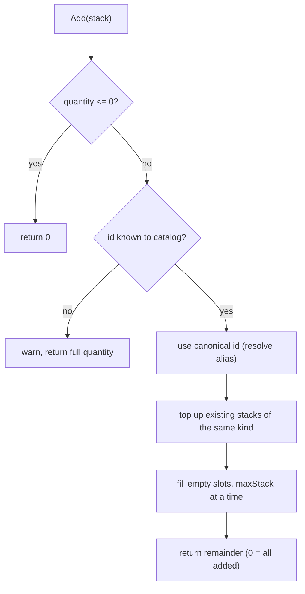

# Inventory

> [Docs index](../README.md) · [Architecture](../ARCHITECTURE.md) · Related: [Items](items.md) · [Save system](save-system.md) · [Screens and UI](screens-and-ui.md#inventorystate)

A slot-based container that holds the player's objects. It stacks, moves, sorts and persists them,
**without knowing what kinds of items exist**.

* Code: `src/core/inventory/Inventory.hpp`, `Inventory.cpp`
* Tests: `tests/test_inventory.cpp`, `tests/test_inventory_persistence.cpp`
* Screen: `src/states/InventoryState.*` ([details](screens-and-ui.md#inventorystate))

## Contents

1. [Design in one paragraph](#design-in-one-paragraph)
2. [Data model](#data-model)
3. [Invariants](#invariants)
4. [Public API](#public-api)
5. [Operation semantics](#operation-semantics)
6. [Persistence](#persistence)
7. [Extending the inventory](#extending-the-inventory)
8. [Tests](#tests)
9. [Limitations](#limitations)

---

## Design in one paragraph

The inventory is a fixed-size array of **slots**. Each slot is either empty or holds one `ItemStack`
(`id`, `quantity`, opaque `state`). The inventory needs only three facts: the item **id** (identity),
**`maxStack`** (asked to an `IItemCatalog`) and the **`state`** (compared and saved, never interpreted).
Everything type-specific lives in the item definition's `properties` and is read by the system that
cares about it. That is why adding weapons, potions or quest items never requires changing this class.
See [Items](items.md) for the definition/instance split.

## Data model

```cpp
class Inventory {
    const IItemCatalog* _catalog;                       // non-owning: "what is maxStack of X?"
    std::vector<std::optional<ItemStack>> _slots;       // empty slot = std::nullopt
    std::uint64_t _revision;                            // bumped on every change
};

struct ItemStack {
    ItemId id;          // "iron_sword"
    int    quantity;    // 1..maxStack
    Json   state;       // {"durability": 37}; null = no per-instance data
};
```

| Property | Value |
|---|---|
| Default capacity | `inventoryCapacity` from `data/new_game.json` (24 in the shipped data) |
| Hard maximum | `Inventory::kMaxCapacity` = **4096** slots |
| Slot index | `0 .. Capacity()-1`, row-major in the UI (6 columns) |
| Two stacks are the "same kind" when | same `id` **and** equal `state` (`null` and `{}` are equal) |

## Invariants

Enforced on **every mutation** (`Add`, `Remove`, `Move`...):

1. A stored quantity is between `1` and the item's `maxStack`.
2. Only **known** item ids can be added.
3. Stacks of the same kind are topped up before a new slot is used.

Loading from a save is deliberately **more tolerant** than mutation (see [Persistence](#persistence)):
invariants 1 and 2 may be temporarily violated by data that came from an older game version, and that
data is kept rather than destroyed.

## Public API

| Method | Returns | Description |
|---|---|---|
| `Inventory(catalog, capacity = 24)` | | Capacity is clamped to `kMaxCapacity`. |
| `Capacity()`, `UsedSlots()`, `FreeSlots()`, `IsEmpty()` | counts | |
| `At(slot)` | `const ItemStack*` | `nullptr` if the slot is empty or out of range. |
| `Count(id)` | `int` | Total quantity of an item across all stacks (any state). Accepts aliases. |
| `Has(id, qty = 1)` | `bool` | `Count(id) >= qty`. |
| `RoomFor(stack)` | `int` | How many units of `stack` could be added right now. |
| `ForEach(fn)` | | Calls `fn(slotIndex, const ItemStack&)` for each occupied slot. |
| `Revision()` | `uint64_t` | Changes whenever the content changes (UI refresh, "dirty" checks). |
| `Add(ItemStack)` | **remainder** `int` | Quantity that did **not** fit (`0` = everything added). `[[nodiscard]]`. |
| `Add(id, qty = 1)` | remainder `int` | Convenience: applies the definition's `defaultState`. `[[nodiscard]]`. |
| `Remove(id, qty = 1)` | `bool` | **All-or-nothing**: removes exactly `qty` or nothing. |
| `RemoveFromSlot(slot, qty)` | `optional<ItemStack>` | Takes up to `qty` from one slot and returns what was taken. |
| `Move(from, to)` | `bool` | Drag and drop: move, merge or swap. `false` if nothing changed. |
| `Sort()` | | Merges partial stacks, orders by category, name, id; packs to the front. |
| `Clear()` | | Empties every slot. |
| `SetCapacity(n)` | `bool` | Grows freely; shrinks only if the removed slots are empty. |
| `ToJson()` | `Json` | See [Persistence](#persistence). |
| `LoadJson(json, warnings*)` | | Replaces the content. Never throws, never drops a valid item. |

## Operation semantics

### Add



The caller must look at the remainder: a non-zero value means the inventory is full.

```cpp
if (player.inventory.Add("potion_health", 5) > 0) {
    // inventory full: tell the player
}
```

### Remove

`Remove(id, qty)` first checks `Count(id) >= qty`; if not, nothing changes and it returns `false`.
Otherwise it takes units **starting from the last slots**, so the front stacks stay full. Slots that
reach zero become empty. It matches by id only (any `state`). To remove a *specific* instance use
`RemoveFromSlot`.

### Move

`Move(from, to)`:

| Target slot | Result |
|---|---|
| empty | the stack is moved |
| same kind (same id and state) | merged up to `maxStack`; the rest stays in the source. Returns `false` if the target is already full |
| different kind | the two stacks are swapped |

Out-of-range indexes, an empty source, or `from == to` return `false`.

### Sort

1. Merge partial stacks of the same kind.
2. Order by `(category, name, id)`. Items with an unknown definition sort **last**.
3. Pack to the front, leaving empty slots at the end.

### Use

Using an item is **not** an inventory operation. The inventory only offers `RemoveFromSlot`; the effect
is decided by an item behaviour. See [Items: behaviours](items.md#behaviours-using-an-item).

## Persistence

JSON layout (embedded in the save file under `player.inventory`):

```json
{
  "capacity": 24,
  "slots": [
    { "slot": 0, "id": "potion_health", "qty": 3 },
    { "slot": 1, "id": "iron_sword",    "qty": 1, "state": { "durability": 100 } }
  ]
}
```

* Only **occupied** slots are written, each **with its slot number**, so the player's layout survives.
* Items are referenced by **string id**, never by index.
* `state` is written only when it is not empty.

### Loading rules (`LoadJson`)

`LoadJson` **never throws** and **never discards a valid item**. Every anomaly is reported in the optional
`warnings` vector and in the log.

| Situation in the file | Behaviour |
|---|---|
| Item id unknown to the current content (removed in an update) | **Kept as-is**, re-saved untouched; reappears if the content comes back |
| Item id is an old alias | Mapped to the canonical id |
| Quantity larger than the current `maxStack` (content rebalanced) | **Tolerated**; new items go to other slots |
| Two items claim the same slot, or a slot is out of range / negative | The later one is **relocated** to the first free slot |
| No free slot to relocate to | **Capacity grows** to keep the item |
| `capacity` missing / invalid | Previous capacity is kept; values above 4096 are clamped |
| Entry with no id, empty id, or quantity < 1 | **Skipped** (unusable), with a warning |
| Whole value is not an object / `slots` is not an array | Inventory left empty / ignored, with a warning |

The first rule of the save system applies here too: **loading never destroys valid player data**
([Save system](save-system.md#guarantees)).

## Extending the inventory

| Goal | How |
|---|---|
| A new kind of item | Add it to `data/items.json`. No C++ needed. See [How-to](../guides/how-to.md#add-an-item). |
| An item with changing data (durability, charges) | Put the initial value in the definition's `defaultState`; read and write `stack.state` from the system that owns that data. |
| A different capacity | Change `inventoryCapacity` in `data/new_game.json`, or call `SetCapacity`. |
| A fact the inventory needs about items (for example weight) | Add a field to `ItemDefinition` and read it through `IItemCatalog`. Do **not** branch on categories inside `Inventory`. |
| A UI feature | Implement it in `InventoryState`, calling the API above. |

## Tests

| File | Covers |
|---|---|
| `tests/test_inventory.cpp` | stacking and remainder, unknown items, aliases, state separation, `defaultState`, `Remove` across stacks, `RemoveFromSlot`, `Move` (move/merge/swap), `Sort`, `SetCapacity`, `RoomFor` |
| `tests/test_inventory_persistence.cpp` | full round-trip with gaps and state, sparse output, unknown items kept, aliases, invalid entries skipped, slot collisions relocated, over-sized stacks tolerated, garbage input never throws |

Run them: [Testing](../guides/testing.md).

## Limitations

* No weight or volume.
* No equipment slots (planned: an `Equipment` map next to the inventory; see [Items](items.md#planned-extensions)).
* "Drop" destroys the item; there are no world pickups yet.
* The UI shows no item icons yet (text only).

---

## Related

[Docs index](../README.md) · [Architecture](../ARCHITECTURE.md) · [Items](items.md) · [Save system](save-system.md) · [Player and session](player-and-session.md) · [Screens and UI](screens-and-ui.md) · [Data files](../reference/data-files.md) · [Testing](../guides/testing.md)
