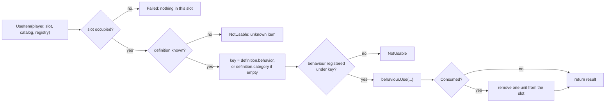

# Items

> [Docs index](../README.md) · [Architecture](../ARCHITECTURE.md) · Related: [Inventory](inventory.md) · [Data files](../reference/data-files.md#itemsjson) · [How-to](../guides/how-to.md#add-an-item)

How objects are described, instantiated and used.

* Code: `src/core/items/*`, `src/core/gameplay/ItemUse.*`
* Data: `data/items.json` ([schema](../reference/data-files.md#itemsjson))
* Tests: `tests/test_save.cpp` (content, item use), `tests/test_inventory.cpp`

## Contents

1. [Definition versus instance](#definition-versus-instance)
2. [ItemDefinition](#itemdefinition)
3. [ItemStack and per-instance state](#itemstack-and-per-instance-state)
4. [The catalogue](#the-catalogue)
5. [Behaviours: using an item](#behaviours-using-an-item)
6. [Planned extensions](#planned-extensions)

---

## Definition versus instance

This split is the central idea of the item system.

| | **ItemDefinition** | **ItemStack** |
|---|---|---|
| Question answered | "What is an iron sword?" | "The player holds 3 swords, one is worn" |
| Lifetime | whole game; loaded from `data/items.json` | lives in an inventory; saved in `saves/` |
| Shared by | all swords | one stack |
| Mutable | no | yes |
| Type-specific data | `properties` (opaque JSON) | `state` (opaque JSON) |

```text
ItemDefinition.properties  {"damage": 7}          static, identical for every iron sword
ItemStack.state            {"durability": 37}     belongs to THIS sword, changes, is saved
```

Both bags are plain JSON that the inventory **stores, copies and compares but never interprets**.
The system that needs a value reads it:

```cpp
int damage = definition.Property<int>("damage", 0);   // combat (future)
int heal   = definition.Property<int>("heal", 0);     // consumable behaviour (today)
```

`Property<T>(key, fallback)` returns `fallback` if the key is missing or has the wrong type; it never throws.

## ItemDefinition

`src/core/items/ItemDefinition.hpp`

| Field | Type | Default | Meaning |
|---|---|---|---|
| `id` | string | **required** | Stable identifier, e.g. `"potion_health"`. Never reuse or change it lightly (saves refer to it). |
| `name` | string | = `id` | Display name |
| `description` | string | `""` | Display text |
| `category` | string | `"misc"` | Free text (`"weapon"`, `"consumable"`, `"quest"`...). Used to sort, to group, and as the default behaviour key |
| `behavior` | string | `""` | Behaviour key; empty = use `category` |
| `maxStack` | int | `1` | Maximum quantity per slot (>= 1) |
| `value` | int | `0` | Gold value |
| `aliases` | string[] | `[]` | Former ids of this item (renames) |
| `tags` | string[] | `[]` | Free labels for future systems |
| `properties` | object | `{}` | Static, type-specific data |
| `defaultState` | object | none | Initial `state` of new instances (e.g. `{"durability": 100}`) |

`ItemDefinition::FromJson` validates the entry and throws `std::runtime_error` with a readable message
(missing `id`, `maxStack < 1`, wrong JSON type...). `ItemDatabase::LoadFromJson` prefixes it with the entry
index (`items[3]: ...`) and `LoadFromFile` with the file name.

## ItemStack and per-instance state

`src/core/items/ItemStack.hpp`

```cpp
struct ItemStack { ItemId id; int quantity = 1; Json state; };
```

* `ItemId` is just `std::string`.
* Two stacks are the **same kind** (`SameKindAs`) if their ids match **and** their states are equal
  (`null` and `{}` count as equal). Only same-kind stacks merge. This is why a worn sword and a new sword
  never melt into one stack, although the inventory has no idea what "durability" means.
* New instances created with `Inventory::Add(id, qty)` get a copy of the definition's `defaultState`.

## The catalogue

`IItemCatalog` (`ItemCatalog.hpp`) is the only thing `Inventory` depends on:

```cpp
class IItemCatalog {
public:
    virtual const ItemDefinition* Find(const ItemId& id) const = 0;     // nullptr if unknown
    virtual ItemId Canonicalize(const ItemId& id) const { return id; } // alias -> current id
};
```

`ItemDatabase` is the real implementation:

* Stores definitions in a `std::deque` so pointers returned by `Find` stay valid when more are added.
* Indexes them by id **and** by alias.
* `Add` rejects duplicate ids and alias conflicts (`std::runtime_error`).

Because of the interface, tests build a tiny catalogue from inline JSON (`tests/TestHelpers.hpp`) instead of
depending on the shipped `data/items.json`.

### Renaming an item without breaking saves

Declare the old id as an alias. Old saves load correctly, and the next save writes the new id.

```json
{ "id": "potion_health", "name": "Health Potion", "aliases": ["health_potion"] }
```

## Behaviours: using an item

`src/core/gameplay/ItemUse.hpp`

A **behaviour** is a class that defines what "use" does for a family of items. The inventory never sees it.

```cpp
class IItemBehavior {
public:
    virtual UseResult Use(PlayerProfile& player,
                          const ItemDefinition& definition,
                          const ItemStack& stack) const = 0;
};

enum class UseOutcome { NotUsable, Failed, Kept, Consumed };
struct UseResult { UseOutcome outcome; std::string message; };
```

| `UseOutcome` | Meaning | Effect on the stack |
|---|---|---|
| `NotUsable` | This kind of item has no use action | none |
| `Failed` | Usable but not right now (e.g. full health) | none |
| `Kept` | Used; the item stays (key, tool) | none |
| `Consumed` | Used; one unit is spent | `RemoveFromSlot(slot, 1)` |

### Resolution



### Built-in behaviour

Registered by `RegisterDefaultBehaviors`:

| Key | Reads | Effect |
|---|---|---|
| `"consumable"` | `properties.heal` (int) | Adds `heal` HP, capped at `maxHealth`. `Failed` if already at full health. `Consumed` otherwise |

Because the default key is the **category**, every item with `"category": "consumable"` and a `heal`
property already works with no extra configuration.

### Adding a behaviour

1. Write a class deriving from `IItemBehavior` in `src/core/gameplay/`.
2. Register it under a key, next to the built-in ones.
3. Give the items that key, either through their `category` or an explicit `"behavior"` field.

Step-by-step with code: [How-to: add an item behaviour](../guides/how-to.md#add-an-item-behaviour).

## Planned extensions

| Idea | Suggested design |
|---|---|
| Equipment (weapon, shield) | An `Equipment` map `slot name -> ItemStack` in `PlayerProfile`, saved like the inventory. `properties.slot` is already present in the shipped items. |
| Item icons | Add an `icon` path to `ItemDefinition`; draw it in `InventoryState`. |
| Weight / encumbrance | Add `weight` to `ItemDefinition`; read it through `IItemCatalog`. |
| Crafting | New rules in `src/core/gameplay/` using `Inventory::Has` / `Remove` / `Add`. |

---

## Related

[Docs index](../README.md) · [Architecture](../ARCHITECTURE.md) · [Inventory](inventory.md) · [Save system](save-system.md) · [Player and session](player-and-session.md) · [Data files](../reference/data-files.md) · [How-to](../guides/how-to.md)
