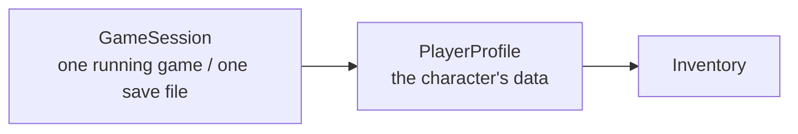
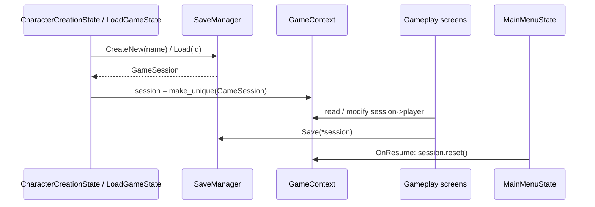

# Player and session

> [Docs index](../README.md) · [Architecture](../ARCHITECTURE.md) · Related: [Save system](save-system.md) · [Inventory](inventory.md) · [Worlds](worlds.md)

What the running game holds about the player, and how it is created, shared and discarded.

* Code: `src/core/player/PlayerProfile.*`, `src/core/save/GameSession.hpp`
* Held by: `GameContext::session` (`std::unique_ptr<GameSession>`, `src/engine/GameContext.hpp`)

## Two objects

### PlayerProfile

Pure data, **no sprite, no window**. This is what gets saved.

| Field | Type | Default | Notes |
|---|---|---|---|
| `name` | string | required | 1-20 printable ASCII characters ([name rules](#character-name-rules)) |
| `level` | int | 1 | At least 1 when loaded |
| `health` | int | 100 | Clamped to `0..maxHealth` when loaded |
| `maxHealth` | int | 100 | At least 1 when loaded |
| `currentWorldId` | string | `""` | Id from `worlds.json`; empty = none chosen yet. See [Worlds](worlds.md) |
| `inventory` | `Inventory` | capacity from `new_game.json` | See [Inventory](inventory.md) |

The constructor takes the item catalogue because the inventory needs it:
`PlayerProfile(catalog, name, inventoryCapacity = 24)`.

### GameSession

The envelope around a `PlayerProfile` for **one save file**.

| Field | Meaning |
|---|---|
| `saveId` | File name without extension (`save_1`) |
| `createdAt`, `updatedAt` | ISO-8601 UTC strings |
| `playTimeSeconds` | Accumulated by `Application` while a session exists |
| `player` | The `PlayerProfile` |

Before this existed, a loaded save was parsed and thrown away, and each screen re-read JSON on its own.
Now **every screen shares the one session** through the context.

## Lifecycle

| Event | What happens to the session |
|---|---|
| New character | Created by `SaveManager::CreateNew`, stored in the context |
| Continue | Loaded by `SaveManager::Load`, stored in the context |
| Any gameplay screen | Reads and modifies `session->player` directly |
| Back to the main menu | `MainMenuState::OnResume` resets it to `nullptr` (the save is already on disk) |
| Window closed | `Application::SaveOnExit` saves it if it exists |

`session == nullptr` therefore means "we are in the menus". Gameplay screens guard with `if (!_ctx.session) return;`.

## Character name rules

`player_name` namespace in `PlayerProfile.hpp`:

| Function | Rule |
|---|---|
| `Normalize(raw)` | Trims leading and trailing spaces |
| `IsValid(name)` | 1 to `kMaxLength` (20) characters, all printable ASCII (codes 32 to 126) |

ASCII only because the current UI font has no accented glyphs; widening the rule means checking the font and
the text-entry filter in `CharacterCreationState`.
`SaveManager::CreateNew` applies both rules and throws `SaveError` if the name is invalid. When **loading**,
any non-empty name is accepted so that an old save is never locked out by a stricter rule.

## Adding a field to the player

See [How-to: add a saved player stat](../guides/how-to.md#add-a-saved-player-stat).

---

## Related

[Docs index](../README.md) · [Architecture](../ARCHITECTURE.md) · [Save system](save-system.md) · [Inventory](inventory.md) · [Worlds](worlds.md) · [Screens and UI](screens-and-ui.md) · [Engine](engine.md#gamecontext)
