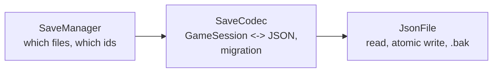
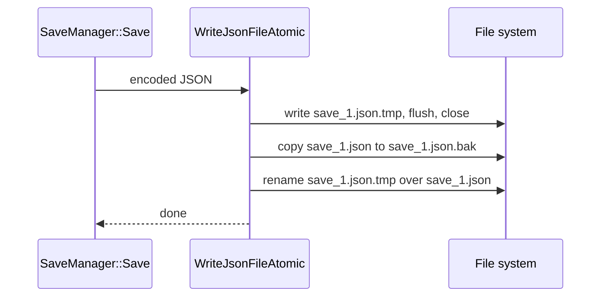
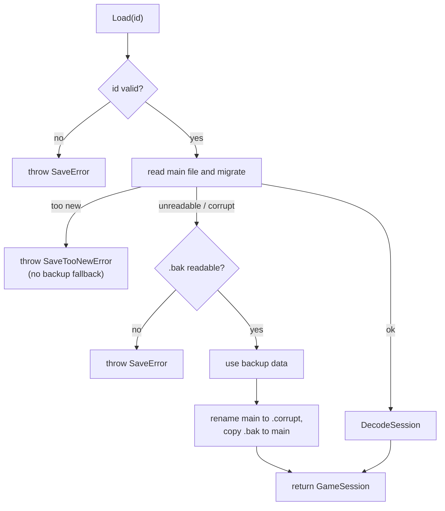

# Save system

> [Docs index](../README.md) · [Architecture](../ARCHITECTURE.md) · Related: [Player and session](player-and-session.md) · [Inventory](inventory.md#persistence) · [Data files](../reference/data-files.md#save-file) · [Prototype migration](../guides/prototype-migration.md)

Turns the running game (`GameSession`) into files and back, safely, across game versions.

* Code: `src/core/save/*`, `src/core/util/JsonFile.*`
* Folder: `saves/` (git-ignored, created at run time)
* Tests: `tests/test_save.cpp`, fixtures in `tests/fixtures/legacy/`

## Contents

1. [Responsibilities](#responsibilities)
2. [Files on disk](#files-on-disk)
3. [File format](#file-format)
4. [SaveManager API](#savemanager-api)
5. [Atomic writes and backups](#atomic-writes-and-backups)
6. [Loading and recovery](#loading-and-recovery)
7. [Versioning and migration](#versioning-and-migration)
8. [Legacy import](#legacy-import)
9. [When the game saves](#when-the-game-saves)
10. [Errors](#errors)
11. [Guarantees](#guarantees)
12. [Evolving the format](#evolving-the-format)

---

## Responsibilities

Three small layers, each with one job:



| Layer | File | Knows about |
|---|---|---|
| `SaveManager` | `SaveManager.*` | the folder, ids, listing, create/load/save/delete, legacy import |
| `SaveCodec` | `SaveCodec.*` | the JSON layout, version numbers, migrations, lenient decoding |
| `JsonFile` | `util/JsonFile.*` | reading JSON, crash-safe writing |

Screens never touch files or JSON: they call `SaveManager` and show the exceptions it throws.

## Files on disk

```text
saves/
├── save_1.json             the save
├── save_1.json.bak         previous good version, refreshed automatically on every write
├── save_1.json.corrupt     a damaged main file kept aside after an automatic repair
└── save_2.json
```

* A save **id** is the file name without `.json`: `save_1`, `save_2`... New ids are the first unused `save_N`.
* Ids are restricted to `[A-Za-z0-9_-]` (max 64 chars). Anything else (`../x`, `a/b`) is rejected, so an id can
  never point outside `saves/`.
* `.tmp` files exist only for the instant of a write.

## File format

Current version: **2** (`kCurrentSaveVersion` in `SaveCodec.hpp`).

```json
{
  "version": 2,
  "meta":   { "createdAt": "2026-06-24T22:57:00Z", "updatedAt": "2026-06-24T23:10:12Z", "playTimeSeconds": 1234.5 },
  "player": {
    "name": "Cedric",
    "level": 1, "health": 100, "maxHealth": 100,
    "currentWorldId": "dark_forest",
    "inventory": {
      "capacity": 24,
      "slots": [
        { "slot": 0, "id": "potion_health", "qty": 3 },
        { "slot": 1, "id": "iron_sword", "qty": 1, "state": { "durability": 100 } }
      ]
    }
  }
}
```

Field-by-field reference: [Data files: save file](../reference/data-files.md#save-file).

Design choices:

* **Versioned**, so old files can be upgraded.
* Content is referenced by **string id** (items, worlds), never by index.
* Inventory writes only occupied slots, **with their slot numbers**.
* Timestamps are ISO-8601 UTC strings, which sort chronologically as plain text.

## SaveManager API

`src/core/save/SaveManager.hpp`

| Method | Description |
|---|---|
| `SaveManager(dir, content)` | `dir` is the save folder; `content` supplies items and worlds |
| `List()` | `vector<SaveSummary>`, newest first. Unreadable files appear with `valid = false` and an `error`, they are never hidden |
| `CreateNew(name)` | Normalises and validates the name, builds the character with the starting kit from `new_game.json`, writes the file, returns the `GameSession`. Throws `SaveError` on an invalid name or I/O failure |
| `Load(id)` | Reads, migrates (and if needed recovers), decodes. Returns a `GameSession`. Throws `SaveError` |
| `Save(session)` | Updates `updatedAt`, then writes atomically. Throws `SaveError` |
| `Delete(id)` | Removes the save and its `.bak`. Returns whether the main file existed |
| `ImportLegacySaves(dir)` | Imports prototype saves ([Legacy import](#legacy-import)). Returns how many |
| `PathFor(id)` | `<dir>/<id>.json` |

`SaveSummary` carries what the Load Game screen needs without decoding a whole session:
`id`, `playerName`, `level`, `worldName`, `updatedAt`, `valid`, `error`.

## Atomic writes and backups

`WriteJsonFileAtomic(path, json, keepBackup)` in `src/core/util/JsonFile.cpp`:



At every instant `save_1.json` is either the complete previous version or the complete new version.
A crash, a power cut or a full disk during the write can only leave a stray `.tmp`; it can never leave a
half-written main file. The `.bak` always holds the previous good version.

## Loading and recovery



* The repair step matters: without it, the next `Save` would copy the **corrupt** main file over the **good**
  `.bak`.
* A file written by a newer game version is **never** replaced by an older backup, because that would silently
  roll the player's progress back.

## Versioning and migration

`MigrateSaveData` upgrades any older layout to the current one, one step at a time. A file with no `version`
field is **version 1** (the original prototype).

| From | To | Change |
|---|---|---|
| 1 | 2 | `player.currentWorld` (display name) becomes `player.currentWorldId` (id, via `WorldDatabase::FindByName`); `version` field added. Health, `meta` and `inventory` get defaults when decoded |

A version **greater** than the game understands throws `SaveTooNewError`.

`DecodeSession` is **lenient**: a missing optional field takes a default (level 1, health = max, no world, empty
inventory...). It throws `SaveError` only when the file is structurally unusable (no `player` object, no name).
Health is clamped to `0..maxHealth`, level to at least 1.

## Legacy import

At every start `Application` calls `SaveManager::ImportLegacySaves("data")`. Files named `data/saveData*.json`
(version 1, from the prototype) are:

1. migrated to the current version,
2. written as new `save_N.json` files,
3. renamed to `*.migrated` so they are imported only once.

A file that cannot be imported is skipped with a warning; it is not touched. Details of the old format and what
changed: [Prototype migration](../guides/prototype-migration.md).

## When the game saves

| Moment | Where |
|---|---|
| A new character is created | `SaveManager::CreateNew` (from `CharacterCreationState`) |
| A world is chosen | `WorldSelectionState` |
| The inventory screen is closed | `InventoryState::OnExit` |
| **F5** in game | `GameplayState` |
| **Esc** in game (back to the menu) | `GameplayState` |
| The window is closed | `Application::SaveOnExit` |

If a save fails, the screen shows the message; leaving to the menu still proceeds.

## Errors

`src/core/save/SaveError.hpp`

| Type | Meaning | Who handles it |
|---|---|---|
| `SaveError` (derives `std::runtime_error`) | Invalid name or id, unreadable save, structurally invalid data, write failure | Screens catch and display `what()` |
| `SaveTooNewError` (derives `SaveError`) | The save comes from a newer game version | Same; never falls back to a backup |

## Guarantees

| Risk | Protection |
|---|---|
| Crash / power cut while writing | Write to `.tmp`, then rename |
| Corrupted main file | Automatic `.bak`, restored on load; damaged file kept as `.corrupt` |
| Item removed from the game | Kept as-is in the inventory and re-saved ([Inventory: loading rules](inventory.md#loading-rules-loadjson)) |
| Item renamed | `aliases` in `items.json` |
| `maxStack` lowered | Existing larger stacks tolerated |
| Save from a future version | Refused explicitly, not "recovered" |
| Malicious or malformed id | Whitelist `[A-Za-z0-9_-]` |
| Format change | Version number plus migration chain |

**Rule of thumb: loading never destroys valid player data.** This is checked by automated tests.

## Evolving the format

* **Adding an optional field** is compatible: decode it with a default when absent. No version bump needed.
* **Renaming, moving or changing the meaning of a field** needs a new version and a migration step.

Procedure: [How-to: change the save format](../guides/how-to.md#change-the-save-format).

---

## Related

[Docs index](../README.md) · [Architecture](../ARCHITECTURE.md) · [Player and session](player-and-session.md) · [Inventory](inventory.md) · [Worlds](worlds.md) · [Data files](../reference/data-files.md) · [Testing](../guides/testing.md) · [Prototype migration](../guides/prototype-migration.md)
