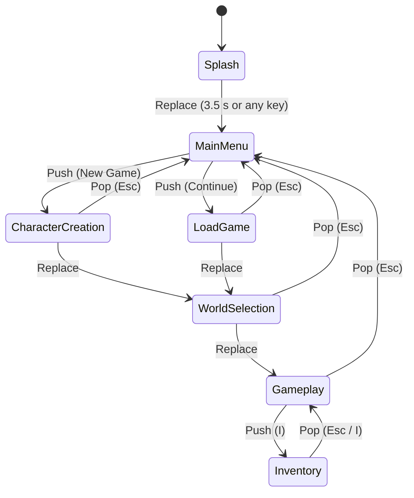

# Screens and UI

> [Docs index](../README.md) · [Architecture](../ARCHITECTURE.md) · Related: [Engine](engine.md) · [Inventory](inventory.md) · [Save system](save-system.md) · [How-to: add a screen](../guides/how-to.md#add-a-screen)

Everything the player sees: the state machine, every screen, the controls, and how to add a screen.

* Code: `src/states/*` (screens), `src/engine/State.hpp`, `src/engine/StateMachine.*`, `src/engine/Input.hpp`, `src/engine/UiHelpers.hpp`

## Contents

1. [Screens as states](#screens-as-states)
2. [Navigation](#navigation)
3. [Controls](#controls)
4. [Screen reference](#screen-reference)
5. [Shared UI helpers](#shared-ui-helpers)
6. [UI rules](#ui-rules)
7. [Adding a screen](#adding-a-screen)

---

## Screens as states

Every screen is a class deriving from `State` (`src/engine/State.hpp`). The main loop only talks to the
interface, so it never needs to know which screen is active.

| Method | Called | Default |
|---|---|---|
| `OnEnter()` | once, when the screen becomes active for the first time (load assets, build sprites) | no-op |
| `OnExit()` | once, just before the screen is destroyed | no-op |
| `OnPause()` | another screen was pushed on top | no-op |
| `OnResume()` | the screen on top was popped | no-op |
| `HandleEvent(event)` | once **per input event** (click, key, text) | **required** |
| `Update(dt)` | at the fixed 1/60 s step | **required** |
| `Draw()` | once per frame | **required** |
| `IsOverlay()` | asked when drawing: if `true`, the screen below is drawn first | `false` |

Each screen receives a `GameContext&` (`_ctx`): window, fade, assets, game content, `SaveManager`, the
current session, and the state machine. See [Engine](engine.md#gamecontext).

## Navigation

`StateMachine` keeps a **stack** of screens. Changes are queued and applied at the start of the next frame,
so a screen is never destroyed while it is executing.

| Call | Effect | Typical use |
|---|---|---|
| `Push(state)` | pause the current screen, show the new one on top | open a sub-screen or an overlay |
| `Replace(state)` | destroy the current screen, show the new one | move forward in a flow |
| `Pop()` | destroy the top screen, resume the one below | go back |

The main menu stays at the bottom of the stack, so **Esc always returns to it**. (In the prototype the menu was
replaced rather than pushed, so Esc on the Load screen emptied the stack and quit the game.)

## Controls

| Screen | Input | Action |
|---|---|---|
| Splash | any key / click | skip |
| Main menu | click "New Game" / "Continue" | open the sub-screen |
| Character creation | type | enter the name (printable ASCII, max 20) |
| | Backspace / Enter / Esc | delete / create the character / back |
| | click "Start game" | create the character |
| Load game | Up / Down | choose a save (wraps around) |
| | Enter / Esc | load / back |
| World selection | Left / Right | browse worlds (wraps around) |
| | Enter / Esc | enter the world / back |
| Gameplay | Arrows, WASD or ZQSD | move |
| | Shift | run |
| | **I** | open the inventory |
| | **F5** | save |
| | **Esc** | save and return to the main menu |
| | **F2** | *debug*: give one random item (`config::kEnableDebugKeys`) |
| Inventory | Arrows | move the cursor |
| | Enter or E | use the selected item |
| | X | drop one unit of the selected stack |
| | Space | pick up, then put down (move, merge or swap) |
| | S | sort |
| | Esc or I | close (and save) |

## Screen reference

### SplashState
Shows the logo with a fade in, waits `kSplashShowTime` (3.5 s), fades out, replaces itself with the menu. Any key or click starts the fade out early. `_leaving` / `_done` guard against requesting the transition twice.

### MainMenuState
Two sprite buttons. Clicks are detected from `MouseButtonPressed` events. `OnResume` resets `_ctx.session`, because coming back to the menu ends the current game.

### CharacterCreationState
Text entry with a name field, a Start button and an error line. Uses `sf::Event::TextEntered` for characters (so keyboard layouts work) and `KeyPressed(Return)` to confirm.
Creation is delegated to `SaveManager::CreateNew`; failures are shown in red under the instructions. A `_started` flag prevents double creation.

### LoadGameState
Lists every save from `SaveManager::List()` (10 visible rows, scrolling). Unreadable saves are shown in red as `[unreadable]` and cannot be loaded; the status line explains why. Loading stores the session in the context and replaces the screen with `WorldSelectionState`.

### WorldSelectionState
One world at a time: name, description, difficulty, required level, counter. Pre-selects the player's current world. Details: [Worlds](worlds.md#world-selection-flow).

### GameplayState
The playable shell: world background, `PlayerAvatar`, HUD (name, level, HP, world), a hint line, and a toast message (`Game saved.`, debug messages). Keyboard movement is **polled** in `Update` (only when the window has focus); actions (I, F5, Esc, F2) are **events**. Fades in over 0.6 s.

### InventoryState
An **overlay**: the game is drawn first, dimmed, then the panel.

* Grid: 6 columns, 96 px slots, up to 6 visible rows (scrolls with the cursor).
* Side panel: name, category, value, `quantity / maxStack`, description, and the raw `state` as "Condition". Items whose definition no longer exists are shown with a warning that they are kept safely in the save.
* A message line reports the result of "use" and "drop".
* `OnExit` saves the session, so everything done here is persisted.

The screen only calls `Inventory` and `UseItem`; it knows no item types. See [Inventory](inventory.md) and [Items](items.md).

## Shared UI helpers

| Helper | File | Purpose |
|---|---|---|
| `input::KeyPressed`, `LeftClick`, `ClickedOn` | `engine/Input.hpp` | Turn an `sf::Event` into intent. One press gives one activation (the prototype polled the mouse state and re-fired while held) |
| `ui::MakeText` | `engine/UiHelpers.hpp` | Build an `sf::Text` with font, size, colour, position |
| `ui::CenterAround` | `engine/UiHelpers.hpp` | Centre a text horizontally |
| `ui::Wrap` | `engine/UiHelpers.hpp` | Approximate word wrap on a character budget |
| `ui::PrettyDate` | `engine/UiHelpers.hpp` | `2026-06-24T22:57:00Z` -> `2026-06-24 22:57` |
| `ui::kInk`, `kMuted`, `kLocked`, `kError`, `kGood` | `engine/UiHelpers.hpp` | The shared colour palette |
| `ScreenFade` | `engine/ScreenFade.*` | Full-screen fade; see [Engine](engine.md#screenfade) |

## UI rules

1. **A screen contains no game rules.** Inventory arithmetic, save format, unlocking: all in `core`. A screen calls and displays.
2. **Catch at the boundary and show the message.** Never let an exception from `SaveManager` end the game.
3. **Assets come from `Config.hpp` paths** through `AssetManager`; do not hard-code a path in a screen.
4. **Use events for discrete actions, polling only for continuous input** (movement).
5. **Guard against a missing session** in any screen that needs it.
6. Put colours and text construction in `UiHelpers.hpp` rather than copying them.

## Adding a screen

Step-by-step: [How-to: add a screen](../guides/how-to.md#add-a-screen).

---

## Related

[Docs index](../README.md) · [Architecture](../ARCHITECTURE.md) · [Engine](engine.md) · [Inventory](inventory.md) · [Worlds](worlds.md) · [Save system](save-system.md) · [Player and session](player-and-session.md) · [Conventions](../guides/conventions.md)
